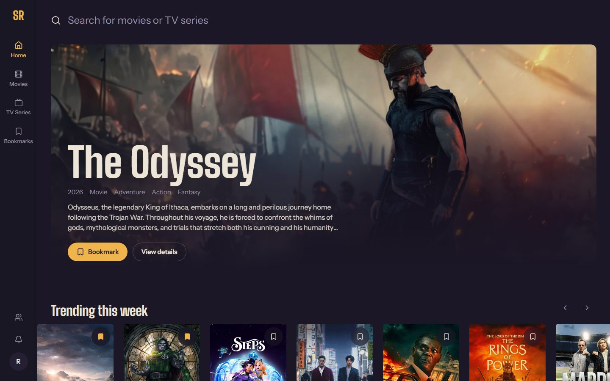
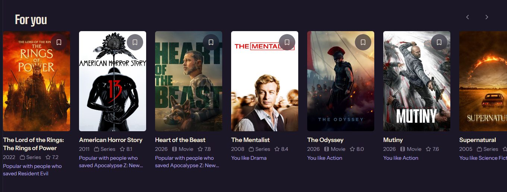
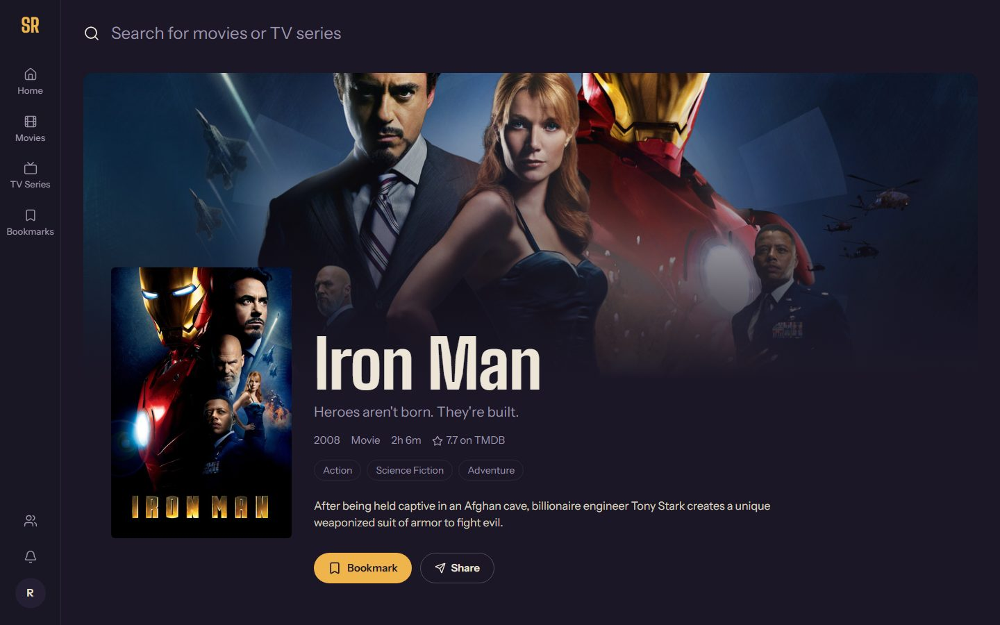
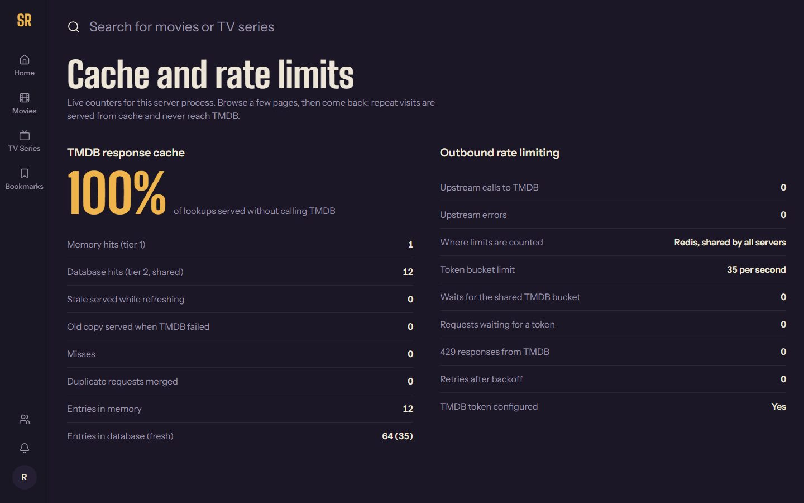
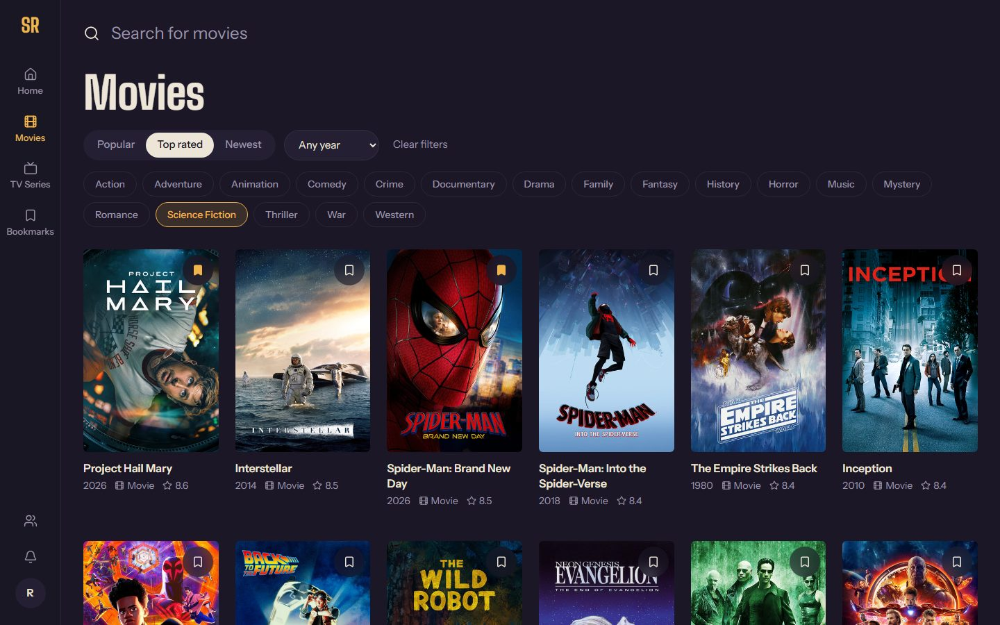

# Screening Room

[](https://github.com/Kerd3/screening-room/actions/workflows/ci.yml)
[](https://screening-room-snowy.vercel.app)

Browse movies and TV series, bookmark what you want to watch, and get recommendations that explain themselves.

**Try it:** [screening-room-snowy.vercel.app](https://screening-room-snowy.vercel.app). Log in with `demo@example.com` / `screening-demo` to see recommendations, friends and shared titles.



## Highlights

- **Built for a rate-limited API.**
  - Every call to TMDB goes through a two-tier cache (memory, then Postgres), with request coalescing and stale-while-revalidate.
  - A token bucket in Redis, shared by every serverless instance, keeps the app under TMDB's rate limit.
  - Repeat browsing is served almost entirely from cache. The live `/stats` page shows the hit rate.
- **Recommendations you can measure.**
  - A hybrid of item-to-item collaborative filtering, genre preference and popularity, learned only from bookmarks, ratings and searches.
  - An offline hold-out test puts it at **20.2% recall@10**: 1.5 times recommending popular titles, with 6 times the catalog coverage.
  - Tuning is confirmed on unseen data with a significance check, and CI fails if quality drops.
- **Tested end to end.** 56 unit tests and 56 Playwright browser tests run on every push, against a fresh Postgres database each time. They cover desktop and phone layouts, plus automated WCAG 2.2 AA accessibility scans of every page.
- **Fast and accessible.** Lighthouse on the live site, simulating a mid-range phone, scores 100 for accessibility on every page. Performance is 72 on Home, 88 on Movies and 92 on title pages, with almost no layout shift.

<table>
  <tr>
    <td width="50%"><br><sub>“For you”: every pick says why it was chosen</sub></td>
    <td width="50%"><br><sub>Title page with rating, reviews and sharing</sub></td>
  </tr>
  <tr>
    <td width="50%"><br><sub><code>/stats</code>: live cache hit rate and rate-limit counters</sub></td>
    <td width="50%"><br><sub>Filters live in the URL, with infinite scroll</sub></td>
  </tr>
</table>

**Stack:** Next.js 16 (App Router, Cache Components), React 19, TypeScript, Tailwind CSS 4, Prisma 7 on Neon Postgres, Upstash Redis, TanStack Query, Vitest, Playwright. Deployed on Vercel.

> Developed an entertainment web app with content organization, bookmarking, and personalized recommendations. Demonstrates third-party API integration, caching strategies for rate-limited APIs, and recommendation algorithms based on user interaction patterns.

## Features

| Area | What it does |
|---|---|
| Browse | Home, Movies, TV Series and Bookmarks pages, all with poster grids and infinite scroll |
| Search | A search bar on every page. Home searches everything, Movies and TV search their own type, and Bookmarks filters your saved list locally |
| Filters | Movies and TV filter by genre (multi-select), sort (popular, top rated, newest) and decade. TV adds a still-airing or ended filter. Filters live in the URL, so a filtered view can be shared |
| Bookmarks | Add or remove from any poster, with optimistic updates. Bookmarks are split into movies and series, and sort by date saved or title |
| Watch history | "Mark as watched" on any title, and a Watch history page grouped by month. Watched titles count toward your taste and are never recommended |
| Import | Bring your history from Letterboxd (watched, diary, ratings, watchlist) or IMDb (ratings, watchlist) exports. The browser reads the CSV and sends it in batches of 50; IMDb ids match TMDB exactly, Letterboxd titles match by name and year |
| Ratings and reviews | Rate 1 to 10 with an optional review. Each title shows the average rating and the reviews posted in the app |
| Recommendations | A "For you" shelf that explains each pick ("Because you bookmarked…", "Popular with people who saved…"). "Not interested" hides a pick for good (with Undo) and nudges its genres down |
| Public profile | Opt-in page at `/u/handle` with favorites (rated 8+), recent watches, top genres and a link preview. Private by default; never shows email, reviews or bookmarks |
| Bookmarked together | Detail pages show what other people saved alongside this title |
| Social | Friend requests by email, sharing a title with a note, a shared-with-you inbox, and viewing a friend's bookmarks |
| Season alerts | New seasons or announced air dates for bookmarked series appear in the bell icon |
| Weekly digest | Opt-in Monday email with new-season news and five fresh picks, sent through Resend, with a one-click unsubscribe link |
| `/stats` | Live cache hit rate, upstream calls, queue depth, 429s and retries |
| Settings | Display name, bookmark privacy, season alerts, weekly digest, history import, and movies/series filter for "For you" |
| Link previews | Shared links show a preview card: each title's backdrop, name, year and rating, generated on the fly |
| Where to watch | Each title lists where to stream, rent or buy it in your country (JustWatch data via TMDB). The country is detected from your location or browser language, and you can change it |

## Architecture

```
 Browser (React client components, TanStack Query)
   │  infinite queries, optimistic bookmark mutations
   ▼
 Next.js route handlers  /api/*  ── Zod validation ── inbound sliding-window limiter (Redis, per user or IP)
   │
   ├─ catalog.ts ─► tmdb client ─► TieredCache ─► shared token bucket (Redis) ─► local TokenBucket ─► withRetry ─► api.themoviedb.org
   │                                 │  tier 1: in-process LRU
   │                                 │  tier 2: Postgres ApiCache (shared by all instances, survives restarts)
   │
   ├─ recs/  signals → GenreAffinity · item-item CF → ItemSimilarity · hybrid blend
   ├─ alerts.ts  TvSnapshot diff → Alert  (Vercel Cron, daily)
   ├─ Prisma 7 + Neon Postgres (pg adapter)
   └─ Upstash Redis: rate-limit counters shared by every serverless instance
```

Also used: iron-session for sessions, Zod for request validation, and MSW to mock TMDB in tests.

**On serverless:** rate limits are kept in Upstash Redis and the second cache tier in Postgres, so both are shared by every instance. Only the first, in-memory cache tier is per instance. Work that should outlive a response (rebuilding similarity, background season checks) runs in `after()`.

## Working with a rate-limited API

All TMDB traffic goes through one function, `tmdb.get()` in `src/lib/tmdb/client.ts`.

**Two-tier cache** (`src/lib/tmdb/cache.ts`):
- Lookups check an in-memory LRU first, then the Postgres `ApiCache` table, so the cache survives restarts and is shared across serverless instances.
- TTL depends on how volatile the data is:

  | Data | TTL |
  |---|---|
  | Genres and configuration | 7 days |
  | Title details | 24 hours |
  | Lists | 1 hour |
  | Search | 10 minutes |
  | TV status, for alerts | 6 hours |

- **Stale-while-revalidate.** An expired entry is returned immediately while it refreshes in the background.
- **Request coalescing.** Ten simultaneous requests for the same key make one upstream call.
- **Serve-stale-on-error.** If TMDB is down or answers 429, any stored copy, however old, is served instead of failing.

**Outbound limiting** (`rateLimiter.ts`, `globalGate.ts`):
- **Shared bucket.** Every TMDB call first takes a token from a token bucket in Upstash Redis (default 35 per second, `TMDB_MAX_RPS`), which all serverless instances share. Together they can't exceed TMDB's limit.
- **Local bucket.** Each instance also keeps its own token bucket, which queues requests rather than dropping them.
- **On a 429:** the whole bucket pauses for `Retry-After`.
- **Retries:** failed calls retry with exponential backoff plus jitter (3 tries). A 404 is not retried.

**Inbound limiting** (`ratelimit-inbound.ts`):
- Sliding windows per signed-in user or IP: search 30 per minute, browsing 120, writes 60.
- Counted in Upstash Redis, so the limit holds however many instances Vercel runs.
- Over the limit, the API returns 429 with `Retry-After`. This keeps one client from draining the shared TMDB quota.

**Failing safe.** Without Redis (local development, CI), on a Redis error, or when Redis takes longer than a second, both layers fall back to per-instance limits. A Redis problem makes limits less exact but never takes the site down. `/stats` shows which mode is active.

**Verified:**
- Two separate servers sharing one Redis each let through only 14 searches from the same client before both refused, because their combined count hit the shared limit.
- On the live site, 32 searches in a row gave 30 allowed and the 31st refused.

**Image loading.** A custom `next/image` loader maps requested widths onto TMDB's CDN size buckets (w185 to w1280), so images aren't optimized twice.

## Recommendations from implicit signals

Preference is inferred from what people save, mark as watched (or import), rate and search for (`src/lib/recs/`).

1. **Signals → genre profile** (`signals.ts`). Each signal adds weight to the title's genres. Weights decay with a 30-day half-life, and TV's combined genres (such as "Sci-Fi & Fantasy") map onto movie genres so one profile covers both.

   | Signal | Weight |
   |---|---|
   | Bookmark | +3 |
   | Watched | +2 (seeing something isn't the same as liking it; ratings say how it went) |
   | "Not interested" | −1.5 (a mild push away; one dismissal shouldn't erase a favorite genre) |
   | Rating | (score − 5.5) × 0.8, so a 2/10 counts against the genre |
   | Clicked search result | +1 |
   | Genre word in a search | +0.5 |

2. **Item-item collaborative filtering** (`collaborative.ts`).
   - Each user is a sparse vector: a bookmark counts 1, a rating of 6 or more counts score/10.
   - Similarity is the cosine between title vectors, kept only when at least 2 users share both titles, and limited to the top 30 neighbors per title.
   - Results are stored in `ItemSimilarity` and rebuilt after the response (throttled to once per 30 seconds) whenever a bookmark or rating changes.
   - The same table powers "Bookmarked together".
3. **Content-based** (`recommend.ts`). Candidates come from TMDB's related titles for your five most recent favorites, plus a discover query on your top three genres. Each is scored by cosine between its genres and your profile.
4. **Hybrid blend** (`hybrid.ts`).
   - The score is `0.5·CF + 0.35·content + 0.15·popularity`.
   - Below 5 signals (cold start), the weights shift to `0.15 / 0.7 / 0.15`.
   - Anything you've already bookmarked or rated is excluded.
   - A greedy diversity pass keeps any one genre to 40% of the shelf.
   - Every pick carries the reason from whichever component contributed most.

### Measuring recommendation quality

`npm run recs:eval` runs an offline hold-out test (`src/lib/recs/evaluate.ts`):

1. For every user with at least 5 liked titles (bookmarked, or rated 6 or higher), it hides a random 20%. Every interaction with a hidden title is removed from training, so nothing leaks.
2. Each strategy is retrained on what's left and ranks the whole local catalog. The strategies call the same scoring functions the app uses in production.
3. It counts how many hidden titles land in each strategy's top 10, averaged over 5 random splits.

The seeded sample users are built to behave like real ones. They pick popular titles more often (with a long tail), lean toward a genre "taste profile", and share a few specific favorite titles within each profile. One group just follows what's popular.

Results on that data (373 titles, 101 users, 3,369 bookmarks and ratings):

| Strategy | Precision@10 | Recall@10 | NDCG@10 | Hit rate@10 | Catalog coverage |
|---|---|---|---|---|---|
| random | 1.3% | 2.7% | 0.019 | 12.7% | 100.0% |
| popularity | 6.6% | 13.6% | 0.111 | 49.3% | 5.4% |
| content-based | 4.2% | 8.6% | 0.070 | 35.8% | 55.2% |
| collaborative | 9.5% | 20.0% | 0.162 | 62.4% | 35.7% |
| hybrid | 9.6% | 20.1% | 0.165 | 65.9% | 31.9% |
| **hybrid + diversity (production)** | **9.7%** | **20.2%** | **0.166** | **65.9%** | **32.2%** |

**What it shows:**
- **Popularity is a strong baseline**, as it is with real users. The production ranking still finds **1.5 times** as many hidden titles, and covers 6 times as much of the catalog.
- **Collaborative filtering does most of the work.** It catches the shared favorites that genre matching can't see. The blend adds a little on top, with the best NDCG and hit rate of all six strategies.
- **Genre matching alone is weak here,** but it still matters for new users, whose recommendations rely mostly on it.

**Caveats:** the users are synthetic, so treat the numbers as a regression baseline, not a claim about real-world accuracy.

### Tuning the blend

`npm run recs:tune` grid-searches every collaborative / genre / popularity weighting in steps of 0.05, combined with four genre-cap settings (924 configurations):

1. It ranks every configuration by NDCG@10 on 5 validation splits.
2. It confirms the winner on 10 separate test splits that played no part in choosing it.
3. A paired test then recommends switching only if the gain on unseen splits is more than two standard errors above zero.

**Outcome: the hand-picked weights stayed.**
- The top 127 configurations are all within about 0.005 NDCG of each other, a flat plateau that the current weights already sit on.
- The validation winner looked 3% better, but on the unseen test splits it was 2% worse, and its catalog coverage fell from 36% to 24%.
- So the tuner keeps the current weights. Shipping the "best" configuration would have meant tuning to noise.

`npm run recs:tune-cf` applies the same protocol to collaborative filtering's own settings, scored inside the full production ranking (400 settings in total):
- minimum users who must have saved both titles (1 to 4),
- neighbors kept per title (10 to 100),
- shrinkage of weakly supported similarities (0 to 25),
- damping of pairs with few co-savers (off to 10).

**Outcome: the current settings stayed.**
- Keeping more neighbors per title (100 instead of 30) looked about 6% better on validation.
- On the unseen test splits the gain was only +0.9% NDCG and +1.1% recall, with no coverage cost.
- The paired check put it within the noise (+0.0017 ± 0.0052 per split), so it wasn't shipped.
- It's a candidate to re-test once there's more real data.

Both searches are in [docs/recommendation-tuning.md](docs/recommendation-tuning.md).

### Guarding quality in CI

CI reruns the evaluation on a freshly seeded database for every push (the "Recommendation quality" job). The build fails if the production ranking:
- stops beating popularity,
- is barely better than random, or
- falls more than 5% below the best single strategy, which would mean blending no longer helps.

The latest local run is saved in [docs/recommendation-evaluation.md](docs/recommendation-evaluation.md).

## Getting started

Requirements: Node 20 or later.

1. Install dependencies. This also generates the Prisma client.

   ```bash
   npm install
   ```

2. Copy `.env.example` to `.env` and fill it in:
   - **`DATABASE_URL`** and **`DATABASE_URL_UNPOOLED`**: a free Neon Postgres database. Use a development branch, not the production one (see Environments and databases below). `npx vercel env pull .env.local` copies the Development values.
   - **`TMDB_READ_TOKEN`**: free from themoviedb.org → Settings → API → *API Read Access Token*.
   - **`SESSION_PASSWORD`**: any random string of 32 or more characters.
   - **`CRON_SECRET`**: any random string.
   - **`KV_REST_API_URL`** and **`KV_REST_API_TOKEN`** (optional): an Upstash Redis database that shares rate limits across servers. On Vercel, add one under Storage → Upstash. Without them, limits are counted per server.

   ```bash
   cp .env.example .env
   ```

3. Create the tables.

   ```bash
   npx prisma migrate deploy
   ```

4. Seed the database: about 370 titles and 100 synthetic users, which collaborative filtering needs to have something to learn from.

   ```bash
   npm run db:seed
   ```

5. Start the dev server at http://localhost:3000.

   ```bash
   npm run dev
   ```

**Demo login:** `demo@example.com` / `screening-demo`. The demo account is seeded with three friends, a pending request and some shared titles.

### Environments and databases

Each environment has its own database, so local work and tests never touch live data:

| Environment | Database |
|---|---|
| Production (Vercel) | Neon `main` branch |
| Preview deployments and local development | Neon `dev` branch, a copy of `main` taken when it was created |
| CI (GitHub Actions) | A throwaway Postgres container, created fresh for every run |

To refresh `dev` with current production data, reset the branch from its parent in the Neon console (or with `neonctl branches reset dev --parent`).

### Continuous integration

`.github/workflows/ci.yml` runs on every push and pull request. It runs lint, type-check (`npm run typecheck`) and the unit tests, then builds the app and runs the Playwright suite (including the axe accessibility scans in `tests/e2e/a11y.spec.ts`) against the production build. The Playwright report is attached to each run. CI needs one repository secret, `TMDB_READ_TOKEN`, and a Dependabot copy of it so dependency PRs can run CI too.

**Production monitoring:**
- **Vercel Speed Insights** records real visitors' load times (Core Web Vitals) per page.
- **Sentry** captures errors from the browser, server rendering and API routes. API routes turn unexpected errors into tidy 500s, so the handler reports them explicitly, after the response is sent.
- Sentry stays off unless `NEXT_PUBLIC_SENTRY_DSN` is set, and its browser SDK loads only then, so pages carry no extra JavaScript otherwise.
- Personal data collection is switched off: no cookies, headers, request bodies, query strings or variable values (`src/lib/sentryPrivacy.ts`).
- `POST /api/debug/error` (protected by `CRON_SECRET`) throws a test error to check the pipeline.
- Both scheduled jobs (`check-seasons` daily, `weekly-digest` on Mondays) report to Sentry cron monitors, so a failed, overrunning or missed run raises an issue. A Sentry uptime monitor checks the home page every 5 minutes.
- Vercel builds upload source maps to Sentry (`withSentryConfig` in `next.config.ts`, using a `SENTRY_AUTH_TOKEN` with upload-only scope), so stack traces show real files and lines. Browser source maps are deleted after upload and never served. Builds without the token skip the upload.

**Repository safety:**
- `main` requires all three CI jobs to pass and can't be force-pushed or deleted.
- Dependabot opens weekly update PRs (minor and patch updates grouped together) plus security fixes.
- CodeQL scans the code, and secret scanning with push protection blocks committed credentials.
- See [SECURITY.md](SECURITY.md) for how to report a vulnerability.

### Scripts

| Script | What it does |
|---|---|
| `npm test` | Unit tests: rate limiter, cache, TMDB client (MSW), recommendation math, alert diffing |
| `npm run test:e2e` | Playwright browser tests: register and log in, the account menu (desktop and mobile), bookmarking, search on every page, infinite scroll and filters. Starts the dev server if one isn't running. Test users are `e2e.*@example.com` and are deleted afterwards. Set `E2E_DATABASE_URL` to use a separate database, or `E2E_BASE_URL` to test a deployed site |
| `npm run recs:rebuild` | Recompute every genre profile and the similarity table |
| `npm run recs:eval` | Offline hold-out evaluation of the recommender against baselines. `-- --write` saves the results to `docs/`, and `-- --check` fails if quality regresses |
| `npm run recs:tune` | Grid search over the blend weights and genre cap, with validation and test splits and a paired significance check (takes about 5 minutes) |
| `npm run recs:tune-cf` | The same search over collaborative filtering's settings (takes about 3 minutes) |
| `npm run alerts:check` | Check bookmarked series for new seasons. Production schedulers call `POST /api/cron/check-seasons` with `Authorization: Bearer $CRON_SECRET` |
| `npm run db:studio` | Browse the database |

## Design

The visual direction ("screening room": velvet background, tungsten accent, Big Shoulders display type) and the reasoning behind it are in [design/DESIGN.md](design/DESIGN.md).
